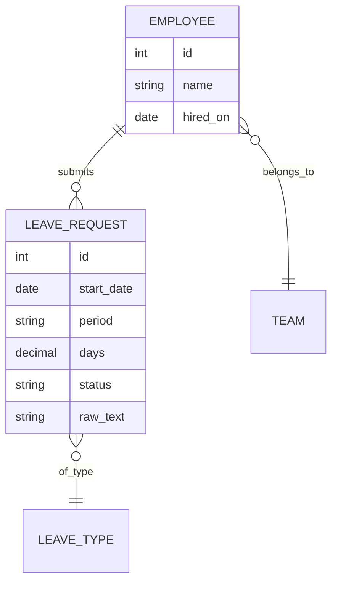

# Day 2｜系統分析與 AI 專案大腦

> **今天結束時**：每組有 `2_architecture.md`、一份專案大腦（`CLAUDE.md` / `AGENTS.md`），以及拆好的第一批票。
> 明天開始的自主期，工程軌要能只靠這三樣東西開工，**不需要再問規格軌**。

| 時間 | 單元 | 產出 |
|---|---|---|
| 09:30–11:00 | 5. 從 PRD 到技術規格 | AI 與規則的邊界 |
| 11:15–12:30 | 6. 架構文件與 Mermaid 圖 | `2_architecture.md` |
| 13:30–15:00 | 7. 建立 AI 專案大腦 | `CLAUDE.md` / `AGENTS.md` |
| 15:15–17:00 | 8. 規格審查與垂直切片拆票 | 第一批票 |

---

## 單元 5｜從 PRD 到技術規格

**為什麼**：PRD 說的是「要什麼」，工程師需要的是「怎麼蓋」。這一步叫**文件降維**：把商業語言降成資料表、API、模組邊界。

### 重點：這個題目最重要的一個架構決策

**哪些事交給 AI，哪些事一定要寫成程式碼？**

| 工作 | 交給誰 | 理由 |
|---|---|---|
| 把「下週三下午」轉成日期與時段 | 🤖 AI | 自然語言的變化無窮，寫規則寫不完 |
| 猜這是什麼假別 | 🤖 AI，但要人確認 | 「看牙醫」可能是病假也可能是特休，猜錯要能改 |
| 算特休剩幾天 | 📏 程式碼 | 算錯一次就是勞資糾紛。同樣的輸入必須永遠得到同樣的答案 |
| 檢查同組撞期 | 📏 程式碼 | 查資料庫就有答案，不需要「理解」 |
| 決定要不要核准 | 👤 主管 | 這是責任，不是運算 |
| 幫主管整理摘要 | 🤖 AI | 摘要錯了，主管看原始假單就知道 |

**判斷口訣**：錯了會不會有人受傷？會 → 程式碼或人。不會，而且規則寫不完 → AI。

### 實作

**全組**：把 `1_requirements.md` 的每一個 Story 填進上面這張表的格式。有爭議的，寫下兩邊的理由。

**規格軌**：特別盯「AI 猜錯的時候會發生什麼事」。每一個交給 AI 的工作，都要有一個「猜錯時的退路」。

**工程軌**：特別盯「AI 回傳的東西長什麼樣」。AI 的輸出要被程式碼接住，所以它的格式必須是固定的（例如 JSON schema）。

### 可以這樣問 AI

```text
讀 @1_requirements.md。把每一個 User Story 拆成具體的工作，
然後幫每一項標記：交給 LLM、寫成程式規則、或由人決定。

每一項都要寫理由。
特別列出：哪些項目你覺得「交給 LLM 很誘人，但其實不該」。
```

### 通過訊號

- [ ] 每一個交給 AI 的工作，都寫了「猜錯時怎麼辦」
- [ ] 「算剩餘天數」「核准」這兩項，都沒有交給 AI

---

## 單元 6｜架構文件與 Mermaid 圖

**為什麼**：架構圖畫在白板上，拍照之後就沒人看了。用 Mermaid 寫在 Markdown 裡，AI 讀得懂、Git 追得到、改了看得出差異。

### 重點

**`2_architecture.md` 只要四段**

| 段落 | 內容 |
|---|---|
| 系統邊界 | 一張流程圖：輸入從哪來、經過哪些元件、存到哪裡 |
| 資料模型 | ERD：有哪些表、欄位、關聯 |
| API | 每支 API 的路徑、輸入、輸出、錯誤情況 |
| 技術決策 | 用了什麼、為什麼、放棄了什麼（不可逆的決策要特別標出來） |

**一張 ERD 的範例骨架**（欄位是示意，你們的要從自己的 PRD 長出來）：



> 注意 `raw_text`：**員工原本打的那句話要存下來。** AI 解析錯了，你才有東西可以回頭查。這是很多人第一版會漏掉的欄位。

**Starter 專案已經決定好的技術選型**：Python、FastAPI、SQLite、pytest。這 4 天不用再選，你只要決定「資料表怎麼設計」和「API 長什麼樣」。

### 實作

**工程軌（主導）**：用 `/to-architecture` 從 `1_requirements.md` 產出 `2_architecture.md` 草稿。

**規格軌**：拿著 `1_requirements.md` 逐條對照，每一條驗收條件都要找得到「架構裡哪一塊負責它」。找不到的，就是架構漏了。

### 可以這樣問 AI

```text
/to-architecture

根據 @1_requirements.md 產出 2_architecture.md，包含：
1. 系統流程圖（Mermaid flowchart）
2. ERD（Mermaid erDiagram）
3. API 規格：路徑、方法、request / response 欄位、錯誤碼
4. 技術決策與理由

限制：技術棧固定為 FastAPI + SQLite + pytest，不要引入其他套件。
LLM 的輸出一律要經過 schema 驗證才能進資料庫。
```

### 通過訊號

- [ ] Mermaid 圖在 GitHub 或 VS Code 預覽裡畫得出來
- [ ] 每一條驗收條件都對應得到架構的某一塊
- [ ] 有一段寫「LLM 回傳格式錯誤時怎麼辦」

### 常見卡關

| 狀況 | 處理 |
|---|---|
| AI 設計出 12 張表 | 問它：「第一版只做員工送出特休，最少需要幾張表？」先做最少的 |
| Mermaid 語法錯誤畫不出來 | 把錯誤訊息貼回給 AI，這種錯它通常一次就修好 |

---

## 單元 7｜建立 AI 專案大腦

**為什麼**：明天開新對話，AI 不記得今天的任何事。`CLAUDE.md`（Claude Code 讀）或 `AGENTS.md`（Codex 讀）是**每次對話開始時它都會自動讀的檔案** —— 你的專案規則要放在這裡，它才會一直記得。

### 重點

**Context 機制：AI 每一次都從零開始**

```text
新對話開始
  → 自動讀 CLAUDE.md / AGENTS.md          ← 專案大腦：每次都在
  → 讀你用 @ 指定的檔案                    ← 這次任務需要的規格
  → 讀你打的這一句                         ← 這次的指令
```

所以專案大腦要放的是**每一次都要遵守的事**，不是這一次的任務。

**專案大腦該寫什麼、不該寫什麼**

| ✅ 該寫 | ❌ 不該寫 |
|---|---|
| 規格在哪：「需求以 `1_requirements.md` 為準」 | 規格內容本身（會跟原檔不同步） |
| 怎麼跑測試：`pytest` | 「請寫出高品質的程式碼」（沒有可檢查的意義） |
| 紅線：「剩餘天數只能由 `rules/` 計算，不准用 LLM」 | 一次性的任務指令 |
| 不准做的事：「不准新增套件，除非先問我」 | 三頁長的背景故事 |

**規則 vs 防線**

寫在 `CLAUDE.md` 的規則，AI **大部分時候**會遵守，但不是每一次。真正不能破的紅線（例如「不准把 API key 寫進程式碼」），要用 hook 或測試擋，讓它**做不到**，而不是叫它**不要做**。這個 repo 的 `.claude/hooks/` 就是例子：你在 Day 1 看到 agent 被擋下來的那一刻，就是 hook 在工作。

### 實作

**全組**：用 `/init` 產生初稿，然後**刪掉一半**。初稿通常太長，而且充滿沒有可檢查意義的句子。

**規格軌**：寫「規格在哪、以哪一份為準、衝突時怎麼辦」這一段。

**工程軌**：寫「怎麼跑、怎麼測、紅線是什麼」這一段。

範本在 [`2-templates/agent-rules/`](../2-templates/agent-rules/)，包含**通用安全模式**與 **TDD 強制模式**兩種。

### 可以這樣問 AI

```text
我要寫這個專案的 CLAUDE.md（或 AGENTS.md）。
讀 @1_requirements.md 和 @2_architecture.md，
列出「每一次寫程式都必須遵守」的規則，最多 15 條。

每一條都要是「可以檢查有沒有做到」的句子。
像「寫好程式」這種無法檢查的，不要列。
```

### 通過訊號

- [ ] 專案大腦少於 60 行
- [ ] **測試它**：開一個新對話，問「特休剩餘天數應該在哪裡計算？」—— 它的答案要和你寫的一致
- [ ] 至少一條紅線，你知道用什麼機制擋（hook、測試、或 code review）

---

## 單元 8｜規格審查與垂直切片拆票

**為什麼**：規格寫完了，但「做請假系統」還是太大，沒辦法交給 AI 一次做完。要切成一張一張的票，每一張都能獨立做完、獨立驗收。

### 重點：垂直切片，不是分層

```text
❌ 分層切法：先做完資料庫 → 再做 API → 再做畫面
   三張票都做完之前，什麼都動不了，也沒辦法驗收任何一張

✅ 垂直切片：每一張票都從頭穿到尾，只是很薄
   票 1：一句寫死的話 → 呼叫 AI → 得到 JSON → 存進資料庫 → 印出來
   票 2：加上「特休剩餘天數」的檢查
   票 3：加上主管核准
```

**第一張票要薄到有點難看。** 寫死一個例句、沒有錯誤處理、沒有畫面都沒關係。它的任務只有一個：證明從頭到尾接得起來。

### 實作

**兩組交換審查（30 分鐘）**：把三份文件交給隔壁組，他們用這張清單檢查：

- [ ] 每條驗收條件都能判斷過了沒
- [ ] 架構裡找得到每條驗收條件的負責元件
- [ ] 專案大腦裡的規則，都和前兩份文件一致

**拆票（全組）**：用 `/to-tickets` 拆出第一批票，至少要有：

1. 第一張垂直切片票（自主期要做的）
2. 兩到三張接在後面的票

### 可以這樣問 AI

```text
/to-tickets

根據 @1_requirements.md 和 @2_architecture.md 拆票。
第一張票必須是垂直切片：從一句寫死的請假句子開始，
經過 LLM 解析，存進資料庫，最後印出結果。
不要做畫面，不要做錯誤處理，不要做登入。

每一張票寫明：做什麼、怎麼驗收、被哪一張票擋住。
```

### 通過訊號

- [ ] 第一張票的驗收條件，是一個能在終端機上跑的指令
- [ ] 沒有任何一張票叫做「建立資料庫」或「做 API 層」

---

## Day 2 覆盤（16:45–17:00）

每組念出自己的第一張票。全班判斷：**它夠薄嗎？** 一個人兩小時內做得完嗎？

→ 下一步：[自主期](./SELF-STUDY.md)
