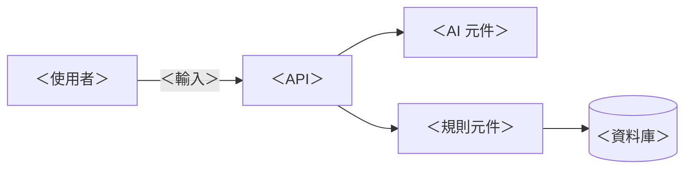
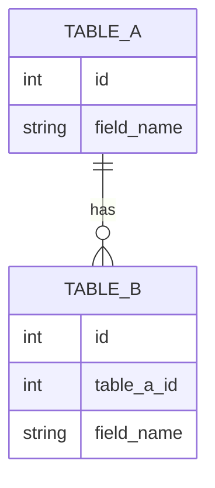

# 2_architecture.md —— ＜專案名稱＞

> 填寫說明：`＜＞` 是要換掉的地方，`💡` 開頭的引言是提示，寫完請刪掉。
> 每一段都要能對應回 `1_requirements.md` 的某個編號。對應不到的設計，通常是多做的。

| 項目 | 內容 |
|---|---|
| 對應需求版本 | `1_requirements.md` ＜v0.1＞ |
| 負責人 | ＜名字＞ |
| 最後更新 | ＜YYYY-MM-DD＞ |

---

## 1. 系統邊界

> 💡 一張圖說清楚：輸入從哪來、經過哪些元件、存到哪裡、誰在外面。



---

## 2. 誰負責什麼

> 💡 有 AI 的系統一定要有這張表。口訣：錯了會有人受傷 → 程式碼或人；規則寫不完而且錯了能補救 → AI。

| 工作 | 負責 | 理由 | 對應需求 |
|---|---|---|---|
| ＜例：解析自然語言＞ | 🤖 AI | ＜理由＞ | US-01 |
| ＜例：計算剩餘額度＞ | 📏 程式碼 | ＜理由＞ | AC-02-1 |
| ＜例：核准＞ | 👤 人 | ＜理由＞ | US-10 |

**AI 輸出的格式**：

```json
{
  "＜欄位＞": "＜型別與允許的值＞"
}
```

**AI 輸出不符合格式時**：＜例：不存進資料庫，回傳「無法理解，請改用表單」＞

---

## 3. 資料模型

> 💡 只畫這一版需要的表。使用者原本輸入的文字建議存下來，AI 出錯時才查得到。



| 表 | 欄位 | 型別 | 說明 | 對應需求 |
|---|---|---|---|---|
| ＜表名＞ | ＜欄位＞ | ＜型別＞ | ＜允許的值、預設值＞ | ＜AC 編號＞ |

---

## 4. API

> 💡 每支 API 都寫錯誤情況。只寫成功路徑的 API 規格，AI 會自己發明錯誤處理。

### `＜METHOD＞ ＜/path＞`

| | 內容 |
|---|---|
| 用途 | ＜一句話＞ |
| 對應需求 | ＜US / AC 編號＞ |
| Request | `{ "＜欄位＞": "＜型別＞" }` |
| Response 200 | `{ "＜欄位＞": "＜型別＞" }` |

| 錯誤情況 | 狀態碼 | 回傳訊息 |
|---|---|---|
| ＜例：額度不足＞ | ＜409＞ | ＜「特休剩餘 0.5 天」＞ |

---

## 5. 技術決策

> 💡 寫「選了什麼、為什麼、放棄了什麼」。標出**不可逆**的決策：改起來要搬資料、要通知別人的那種。

| 決策 | 選擇 | 放棄的選項 | 理由 | 可逆嗎 |
|---|---|---|---|---|
| ＜例：資料庫＞ | ＜SQLite＞ | ＜PostgreSQL＞ | ＜理由＞ | ＜可逆 / ⚠️ 不可逆＞ |

---

## 6. 安全與紅線

| 紅線 | 用什麼擋 |
|---|---|
| ＜例：API key 不進版控＞ | ＜`.gitignore` 加 `.env`，再加 guard hook＞ |
| ＜例：AI 不能改假單狀態＞ | ＜AI 的輸出 schema 沒有 status 欄位＞ |

> 💡 「用什麼擋」不能填「在 prompt 裡叫它不要」—— 那是建議，不是防線。

---

## 寫完後的自我檢查

- [ ] 每條驗收條件都對應得到架構裡的某一段
- [ ] Mermaid 圖在預覽裡畫得出來
- [ ] 每支 API 都有錯誤情況
- [ ] 「誰負責什麼」裡，會讓人受傷的工作沒有交給 AI
