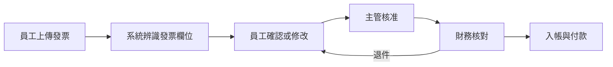

# 請款系統（財務）

> **一句話**：員工上傳發票或收據申請報銷，主管與財務審核後付款。
> **難度**：⭐⭐ —— 流程簡單，但金額一定要對，而且多了「讀發票」這個多模態需求。

---

## 需求重點

| 角色 | 核心 User Story |
|---|---|
| 員工 | 拍照上傳發票、填用途、追蹤審核進度 |
| 主管 | 核准部門費用、看部門預算剩多少 |
| 財務 | 核對發票真偽與金額、入帳、付款 |

**最常被漏掉的需求**

- 一張發票拆給兩個專案怎麼辦？
- 外幣收據的匯率用哪一天的？
- 同一張發票被重複申請要擋下來。
- 超過一定金額要多一層核准。

---

## 流程

---

## 架構

| 層 | 內容 |
|---|---|
| 前端 | 手機拍照上傳、申請單表單、審核清單 |
| 後端 | 檔案上傳、發票辨識、審核流程、重複檢查 |
| 資料 | 申請單、發票（原始圖檔＋辨識結果）、費用類別、預算、審核紀錄 |
| 外部整合 | 會計系統、匯率來源、電子發票平台（若有） |

**關鍵設計**：原始圖檔、AI 辨識結果、員工確認後的值，**三份都要存**。財務稽核時要看得到「AI 讀成什麼、人改成什麼」。

---

## AI 在這裡

| ✅ 適合交給 AI | ❌ 不該交給 AI |
|---|---|
| 從發票照片讀出日期、統編、金額 | 決定最後入帳的金額（要人確認） |
| 依用途描述建議費用類別 | 核准或退件 |
| 偵測「這張看起來像重複申請」並提醒 | 判斷發票真偽（要查官方來源） |

---

## 常見坑

| 坑 | 為什麼會發生 | 怎麼避免 |
|---|---|---|
| 金額小數點讀錯 | 照片模糊，AI 很有自信地讀錯 | 辨識結果一律要員工確認，金額欄位醒目顯示 |
| 重複申請沒擋到 | 只比對檔名，不比對發票號碼 | 用發票號碼＋金額＋日期做唯一性檢查 |
| 預算超支 | 核准時沒有即時查預算 | 核准前由程式碼算出「核准後剩餘預算」給主管看 |

---

## 第一張垂直切片

> 上傳一張發票照片 → AI 讀出金額與日期 → 員工在頁面上確認 → 存進資料庫。

不做審核流程、不做預算、不做會計整合。先證明「讀發票 → 人確認 → 存下來」接得起來。
