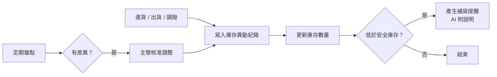

# 庫存系統（營運）

> **一句話**：記錄每一筆進貨、出貨、調撥、盤點，隨時知道每個倉庫每樣東西還剩多少。
> **難度**：⭐⭐⭐ —— 數量錯一次就是缺貨或積壓，而且多人同時操作會出現併發問題。

---

## 需求重點

| 角色 | 核心 User Story |
|---|---|
| 倉管 | 登記進出貨、調撥、盤點 |
| 業務 | 查詢可出貨數量 |
| 營運主管 | 看庫存水位、低於安全庫存的品項、呆滯品 |

**最常被漏掉的需求**

- 「帳上庫存」和「可用庫存」不一樣（已被訂單保留的不能再賣）。
- 盤點時發現差異，要怎麼調整、誰核准？
- 兩個人同時出同一批貨，不能出成負數。
- 批號與效期（食品、藥品）。

---

## 流程

---

## 架構

| 層 | 內容 |
|---|---|
| 前端 | 倉管作業畫面（掃條碼友善）、庫存查詢、主管儀表板 |
| 後端 | 異動 API、庫存計算、保留（reservation）、盤點調整、補貨規則 |
| 資料 | 品項、倉庫、**庫存異動紀錄**（每一筆都留）、庫存快照、安全庫存設定 |
| 外部整合 | ERP、訂單系統、條碼／RFID |

**關鍵設計**：庫存數量不是一個直接被改寫的欄位，而是**所有異動紀錄加總的結果**。只能新增異動，不能修改或刪除舊的異動。數量對不上時，才查得出是哪一筆造成的。

---

## AI 在這裡

| ✅ 適合交給 AI | ❌ 不該交給 AI |
|---|---|
| 偵測異常：「這個品項上週出貨量是平常的 5 倍」 | 庫存數量的計算與異動 |
| 為補貨建議寫說明：「因為下個月有促銷活動」 | 自動下採購單 |
| 用白話查詢：「台中倉還有多少 A 款？」（查詢由程式碼執行） | 盤點差異的調整 |

---

## 常見坑

| 坑 | 為什麼會發生 | 怎麼避免 |
|---|---|---|
| 庫存變成負數 | 兩個請求同時讀到「還有 1 個」 | 扣庫存用資料庫交易與條件更新，並寫併發測試 |
| 數量對不上卻查不出原因 | 直接改庫存欄位，沒留異動紀錄 | 只允許新增異動，庫存由異動推算 |
| AI 查詢給了錯的數字 | 讓 AI 自己寫 SQL 並相信結果 | AI 只選擇要用哪個查詢，查詢本身是寫好、測過的 |

---

## 第一張垂直切片

> 登記一筆進貨、一筆出貨 → 從異動紀錄算出目前庫存 → 出貨超過庫存時擋下。

不做多倉、不做保留、不做 AI。先把「庫存永遠由異動推算、不會變負數」用測試鎖住。
