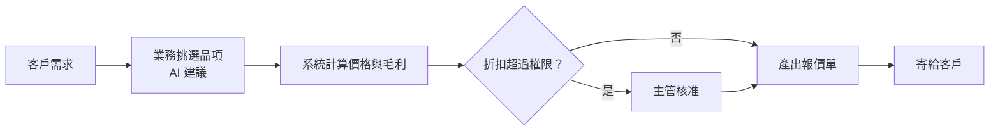

# 報價單系統（業務）

> **一句話**：業務依客戶需求挑產品、算價格、套折扣，產出一份能寄給客戶的報價單。
> **難度**：⭐⭐ —— 流程不複雜，但價格與毛利是公司最敏感的數字。

---

## 需求重點

| 角色 | 核心 User Story |
|---|---|
| 業務 | 依客戶需求建立報價單、套用折扣、產出 PDF 寄出 |
| 業務主管 | 核准超過權限的折扣、看團隊報價狀況 |
| 產品／定價 | 維護產品目錄、牌價、折扣規則 |

**最常被漏掉的需求**

- 報價單有效期限到了，價格要不要自動失效？
- 牌價調整後，已寄出的報價單不能跟著變。
- 同一個客戶改了三次報價，要留版本紀錄。
- 毛利低於多少要擋下來，或要主管核准。

---

## 流程

---

## 架構

| 層 | 內容 |
|---|---|
| 前端 | 報價編輯器（選品項、調數量、看即時總價與毛利）、核准清單 |
| 後端 | 產品目錄、定價引擎、折扣規則、PDF 產生、版本管理 |
| 資料 | 產品、牌價（含生效日期）、客戶、報價單（含版本）、報價明細 |
| 外部整合 | CRM、ERP（成本與庫存）、Email |

**關鍵設計**：報價單送出時，把當下的價格**複製一份**存進報價明細，不要只存產品 ID。牌價之後怎麼改，已寄出的報價單都不受影響。

---

## AI 在這裡

| ✅ 適合交給 AI | ❌ 不該交給 AI |
|---|---|
| 從客戶的需求描述（Email、會議紀錄）建議品項清單 | 計算價格、折扣、稅額、毛利 |
| 草擬報價單的說明文字與提案摘要 | 決定給多少折扣 |
| 比對「這個客戶過去買過什麼」給建議 | 判斷報價是否能送出 |

---

## 常見坑

| 坑 | 為什麼會發生 | 怎麼避免 |
|---|---|---|
| 總價算錯 | 讓 AI 直接產出含價格的報價單 | AI 只產出品項與數量，價格一律由定價引擎算 |
| 舊報價單金額跟著變 | 明細只存產品 ID | 送出時複製當下價格 |
| 四捨五入差一塊錢 | 每一行先四捨五入再加總，和先加總再四捨五入結果不同 | 在規格裡寫清楚捨入規則，並寫測試 |

---

## 第一張垂直切片

> 選兩個產品、填數量 → 定價引擎算出總價 → 存成一張報價單 → 印出明細。

不做 AI 建議、不做折扣、不做 PDF。先把「價格一定算對」這件事用測試鎖住，再讓 AI 進來幫忙挑品項。
