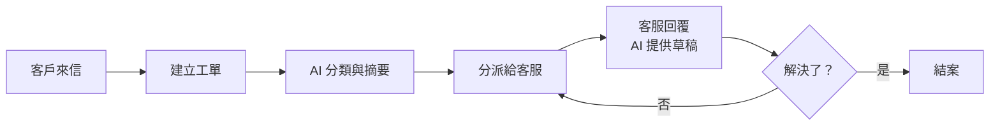

# 客服工單系統（客服）

> **一句話**：把客戶從各管道來的問題變成工單，分派給對的人，追蹤到結案。
> **難度**：⭐⭐ —— AI 能幫上很多忙，但每一句回給客戶的話都代表公司。

---

## 需求重點

| 角色 | 核心 User Story |
|---|---|
| 客戶 | 透過 Email、表單或聊天送出問題，知道處理進度 |
| 客服人員 | 看到分好類的工單、快速回覆、轉給其他部門 |
| 客服主管 | 看待處理量、回覆時間、哪類問題最多 |

**最常被漏掉的需求**

- 同一個客戶短時間寄三封信，要合併成一張工單。
- 工單轉給其他部門後，誰負責催？
- SLA（多久內要回覆）依客戶等級不同。
- 客戶來信裡有個資，誰能看？

---

## 流程

---

## 架構

| 層 | 內容 |
|---|---|
| 前端 | 客服工作台（工單清單、對話紀錄、回覆編輯器）、主管儀表板 |
| 後端 | 收信／收表單、工單狀態機、分派規則、SLA 計時 |
| 資料 | 客戶、工單、對話紀錄、分類、知識庫文章 |
| 外部整合 | 信箱、客戶資料系統（CRM）、知識庫 |

**關鍵設計**：工單狀態（新建、處理中、等客戶回覆、已結案）是一個明確的狀態機，由程式碼控制轉換，AI 不能直接改狀態。

---

## AI 在這裡

| ✅ 適合交給 AI | ❌ 不該交給 AI |
|---|---|
| 依內容分類、判斷急迫程度 | 承諾退款、賠償或任何條件 |
| 把長篇來信摘要成三行 | 未經人看過就把回覆寄給客戶 |
| 從知識庫找相關文章，草擬回覆 | 關閉工單 |
| 偵測客戶情緒，標記需要主管關注的工單 | 決定客戶等級或 SLA |

---

## 常見坑

| 坑 | 為什麼會發生 | 怎麼避免 |
|---|---|---|
| AI 草稿承諾了做不到的事 | 知識庫沒寫的，它會自己編 | 草稿只能引用知識庫內容，沒有依據就說「需要確認」 |
| 客戶來信藏著 prompt injection | 來信內容直接放進 prompt | 來信放在明確標記的資料區塊，AI 輸出只能是固定欄位 |
| 個資外洩到 AI 服務 | 整封信原封不動送出 | 送出前先遮蔽身分證、電話、地址 |

---

## 第一張垂直切片

> 貼上一封客戶來信 → AI 產生分類與三行摘要 → 存成一張工單 → 在清單上看得到。

不做收信整合、不做回覆、不做分派。先證明「來信 → 結構化工單」這一段可行，並用 20 封真實（去識別化）來信做 eval。
