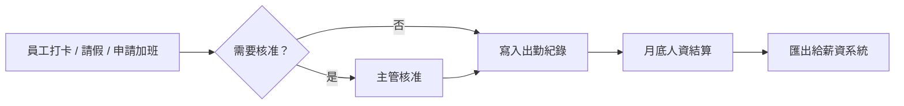

# 差勤系統（人資）

> **一句話**：記錄上下班、請假、加班，月底算出每個人的出勤結果給薪資用。
> **難度**：⭐ —— 規則明確、每個人都懂，是 4 天課程的主線題目（LeaveBot 就是它的一部分）。

---

## 需求重點

| 角色 | 核心 User Story |
|---|---|
| 員工 | 打卡、請假、申請加班、查自己的出勤紀錄 |
| 主管 | 核准請假與加班、看團隊出勤狀況 |
| 人資 | 維護規則（假別、班別、國定假日）、月底結算、匯出給薪資 |

**最常被漏掉的需求**

- 忘記打卡怎麼補？誰核准？
- 跨日班（晚上 10 點到隔天早上 6 點）算哪一天？
- 規則改了（例如新年度特休天數），舊資料要不要重算？
- 離職員工的未休特休怎麼結算？

---

## 流程

---

## 架構

| 層 | 內容 |
|---|---|
| 前端 | 員工端（手機優先）、主管待審清單、人資管理後台 |
| 後端 | 打卡 API、假單 API、規則引擎、月結批次 |
| 資料 | 員工、班別、打卡紀錄、假單、加班單、國定假日、結算結果 |
| 外部整合 | 門禁或打卡機、薪資系統、人事主檔 |

**關鍵設計**：規則（假別額度、加班費倍率）放在資料表裡由人資維護，不寫死在程式碼。法規一改，人資自己就能更新。

---

## AI 在這裡

| ✅ 適合交給 AI | ❌ 不該交給 AI |
|---|---|
| 把「下週三下午看牙醫」轉成假單草稿 | 計算剩餘特休、加班時數、加班費 |
| 每月寫出「異常出勤摘要」給主管看 | 判斷是否違反勞動法規 |
| 回答員工「我還有幾天特休？」（查詢結果由程式碼算，AI 只負責說人話） | 核准請假或加班 |

---

## 常見坑

| 坑 | 為什麼會發生 | 怎麼避免 |
|---|---|---|
| 加班費算錯 | 讓 AI 直接寫計算邏輯，沒有用法規案例測試 | 每一條計算規則都有對照實際案例的測試 |
| 國定假日錯一天 | 補班、補假每年不同 | 假日表由人資每年匯入，不要讓程式自己推算 |
| 規則改了，歷史資料被重算 | 結算時即時套用最新規則 | 結算結果存成快照，規則有生效日期 |

---

## 第一張垂直切片

> 員工送出一筆整天特休 → 檢查剩餘天數 → 存進資料庫 → 回傳剩餘天數。

不做打卡、不做加班、不做主管核准。這就是 4 天課程的 LeaveBot，完整題目見 [`LEAVEBOT.md`](https://github.com/Zenobia000/leavebot-bootcamp/blob/main/LEAVEBOT.md)。
