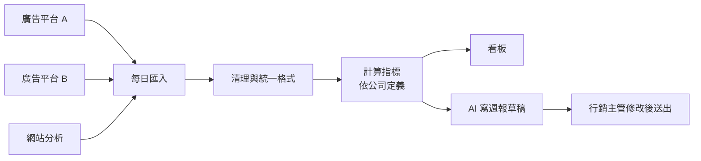

# 活動成效看板（行銷）

> **一句話**：把各個廣告平台與網站的數據匯在一起，讓行銷人員看得出哪個活動有效。
> **難度**：⭐⭐⭐ —— 資料來源多、格式不一，而且「轉換率」這種詞每個人的定義都不一樣。

---

## 需求重點

| 角色 | 核心 User Story |
|---|---|
| 行銷人員 | 看每個活動的曝光、點擊、轉換、花費 |
| 行銷主管 | 比較活動成效、決定預算分配、每週向上報告 |
| 數據／IT | 維護資料串接、確保數字正確 |

**最常被漏掉的需求**

- 「轉換」到底指什麼？註冊、加購物車、還是付款？**這一題要先問清楚。**
- 各平台的歸因方式不同，同一筆訂單可能被兩個平台都算進去。
- 資料延遲：今天看到的昨天數字，明天可能會變。
- 幣別與時區。

---

## 流程

---

## 架構

| 層 | 內容 |
|---|---|
| 前端 | 看板（篩選活動、日期、平台）、指標定義頁、週報編輯 |
| 後端 | 各平台串接、排程匯入、指標計算、AI 摘要 |
| 資料 | 原始數據（依來源保存）、清理後數據、**指標定義**、活動主檔 |
| 外部整合 | 各廣告平台 API、網站分析工具、試算表 |

**關鍵設計**：把**指標定義**寫成文件與程式碼，並放在看板上讓人看得到：「轉換率 = 付款訂單數 ÷ 點擊數，不含退款」。定義不寫清楚，看板上的數字就沒有人敢用。

---

## AI 在這裡

| ✅ 適合交給 AI | ❌ 不該交給 AI |
|---|---|
| 把每週數據寫成白話週報草稿 | 計算任何指標 |
| 回答「上個月哪個活動 CP 值最高？」（數字由查詢算出，AI 只負責說明） | 定義指標 |
| 標記異常：「這個活動的點擊率突然掉了一半」 | 決定預算分配 |

---

## 常見坑

| 坑 | 為什麼會發生 | 怎麼避免 |
|---|---|---|
| 兩個人看到不同的轉換率 | 指標定義只存在某人腦袋裡 | 指標定義寫進 `docs/03-srs.md`，並有標了 `req` 的測試 |
| AI 週報裡的數字和看板不一樣 | 讓 AI 自己從原始資料算 | AI 只能引用已算好的指標，不能自己算 |
| 某平台 API 改版，資料默默斷掉 | 匯入失敗沒有告警 | 每日匯入的筆數與前一天差太多就通知 |

---

## 第一張垂直切片

> 匯入一個平台的 CSV → 依寫好的定義算出點擊率與轉換率 → 在一張表格上顯示。

不做多平台、不做圖表、不做 AI。先把「指標定義」寫成規格與測試，這是整個看板唯一不能錯的地方。
