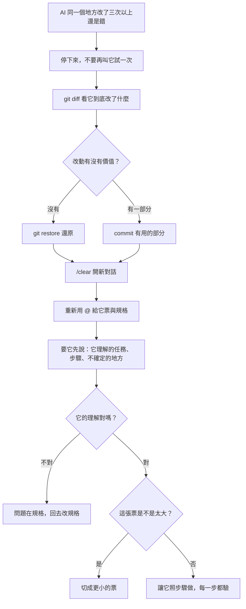
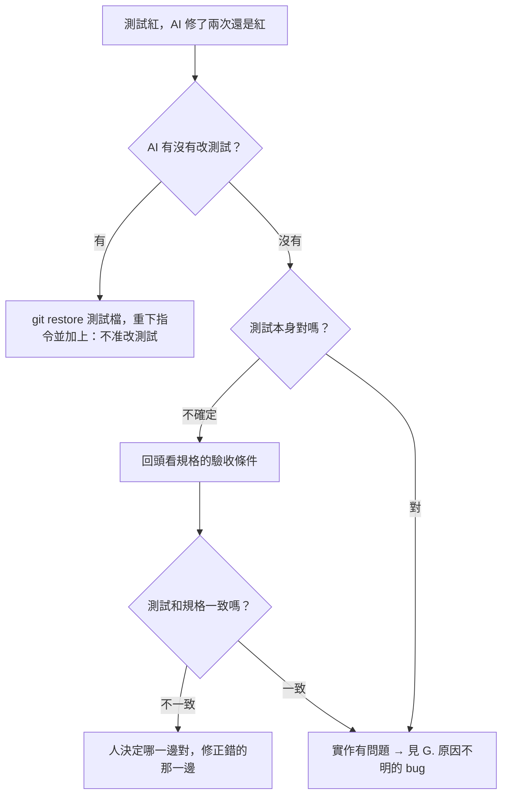

# AI 開發問題排解檢索表

> 先找症狀，照步驟做。**每一步做完都先檢查有沒有好，好了就停。**
> 對應的提示詞在 [Prompt 魔法書](./prompt-book.md) 的卡 I 與第三篇「通用技巧」。

---

## 症狀索引

| 症狀 | 跳到 |
|---|---|
| AI 改了又改，越改越糟，一直繞圈 | [A. 重構死循環](#a-重構死循環) |
| AI 做出來的東西不是我要的 | [B. 誤解需求](#b-誤解需求) |
| AI 說完成了，但根本不能跑 | [C. 假完成](#c-假完成) |
| 測試失敗，AI 修不好 | [D. 修不好的測試](#d-修不好的測試) |
| AI 改了一大堆我沒叫它改的檔案 | [E. 範圍失控](#e-範圍失控) |
| AI 忘記我之前講過的規則 | [F. 忘記規則](#f-忘記規則) |
| 跑起來會壞，但不知道為什麼 | [G. 原因不明的 bug](#g-原因不明的-bug) |
| app 起不來、畫面讀不到 API | [H. 環境起不來](#h-環境起不來) |
| 檢查點時間到了還沒做完 | [I. 進度落後](#i-進度落後) |
| Archify 畫不出圖 | [J. Archify 跑不動](#j-archify-跑不動) |

---

## A. 重構死循環

**為什麼要開新對話**：繞圈的對話裡塞滿了失敗的嘗試，AI 會被自己之前的錯誤答案影響。真正需要的資訊在檔案裡，不在對話裡。

---

## B. 誤解需求

| 步驟 | 做什麼 |
|---|---|
| 1 | 找出它誤解的是**哪一句**規格 |
| 2 | 那一句規格是不是能有兩種解讀？是 → 改規格，不是改程式 |
| 3 | 規格根本沒寫這件事？→ 補進 `docs/02-prd.md` 或 `docs/03-srs.md`，或放進待決事項 |
| 4 | 規格寫了，但它沒讀到？→ 檢查提示詞有沒有 `@` 那份檔案 |
| 5 | 記進 `docs/LESSONS.md` 的「AI 誤解了哪一句規格」。同一類誤解出現第二次，就把對應規則寫進 `AGENTS.md` 的「本專案」段 |

**不要做的事**：在對話裡口頭糾正它，然後繼續。下一段對話它會再犯一次。

---

## C. 假完成

| 步驟 | 做什麼 |
|---|---|
| 1 | 自己跑驗收指令，不要相信它的「完成了」 |
| 2 | 要它跑測試並**貼出完整輸出** |
| 3 | 經常發生 → 在 `AGENTS.md` 加上：「說完成之前，必須跑過測試並貼出結果」 |
| 4 | 還是發生 → 裝上課 repo 的 [`course/templates/hooks/pytest-on-stop.sh`](https://github.com/Zenobia000/leavebot-bootcamp/tree/main/course/templates/hooks)，讓它測試沒過就不能結束 |

---

## D. 修不好的測試

**紅線**：測試和規格衝突時，**由人決定**哪一邊對。不要讓 AI 選。

---

## E. 範圍失控

| 步驟 | 做什麼 |
|---|---|
| 1 | `git diff --stat` 看改了哪些檔案 |
| 2 | 和票無關的改動 → `git restore <檔案>` 還原 |
| 3 | 下次提示詞加上：「只改這張票需要的檔案。需要改其他檔案時，先問我」 |
| 4 | 經常發生 → 把這句寫進 `AGENTS.md` |

---

## F. 忘記規則

| 原因 | 處理 |
|---|---|
| 規則只講在對話裡 | 寫進 `AGENTS.md` / `CLAUDE.md` |
| 對話太長，早先的內容被擠掉 | `/compact` 壓縮，或 `/clear` 重開 |
| 規則寫在檔案裡，但它還是違反 | 這條規則需要防線，不是文字：用 hook 或測試擋 |
| `AGENTS.md` 太長 | 刪到 60 行以內。規則越多，每一條被遵守的機率越低 |

---

## G. 原因不明的 bug

| 步驟 | 做什麼 |
|---|---|
| 1 | **先重現**：找到一個每次都會壞的輸入 |
| 2 | 把它寫成一個會失敗的測試 |
| 3 | 縮小：刪掉不相關的部分，直到剩下最少的程式碼還是會壞 |
| 4 | 要 AI 列出 3 個可能原因，**每個附一個能驗證的方法** |
| 5 | 一次只驗一個原因 |
| 6 | 修好之後，第 2 步的測試留著，當作回歸測試 |

上課 repo 的 `/diagnosing-bugs` 技能會帶你走這個流程。

---

## H. 環境起不來

| 症狀 | 處理 |
|---|---|
| `uvicorn` 找不到 | 沒用 venv 裡的。一律打 `.venv/bin/uvicorn app.main:app --app-dir backend --reload`（Windows：`.venv\Scripts\uvicorn …`） |
| 說 port 8000 已被佔用 | 前一次沒關乾淨。加 `--port 8100` 換一個，或關掉佔用的程式 |
| 首頁打開是 404 | `static/` 沒掛在 `/`。照 `course/STACK.md` 的骨架段第 3 步，請 agent 修 `backend/app/main.py` |
| 首頁讀不到 `/api/health` | 前端寫死了 `http://localhost:8000`。改成相對路徑 `/api/...`，**不要**在後端開 CORS |
| `pytest` 收不到測試或 import 失敗 | `pyproject.toml` 的 pytest 設定不對，對照 `course/STACK.md`：`testpaths`、`pythonpath`、`--import-mode=importlib` |
| `pytest` 警告 `req` 不是登記過的 marker | `pyproject.toml` 沒登記 `req` marker |
| agent 要裝新套件 | 先停。照 `course/STACK.md`，要加套件要先問講師 |
| `pip install` 卡住不動 | Python 不是 3.12，見[課前準備](../00-setup.md) |

---

## I. 進度落後

| 步驟 | 做什麼 |
|---|---|
| 1 | 檢查點時間到了還沒過，落後超過 15 分鐘，**不要硬撐**：卡在上午的組，下午就看不到測試先行 |
| 2 | 把現在的進度 commit 留著：`git add docs/ issues/ backend/` 等你們的檔案，再 `git commit -m "wip: …"` |
| 3 | 切到講師的 checkpoint：`git fetch upstream`，再 `git switch -c rescue-cpN upstream/<分支>`。分支對照見 [D2 開頭](../03-day2.md#落後了怎麼切-checkpoint) |
| 4 | 看分支 README 頂端那一行，從它說的下一張卡接著做 |
| 5 | 課後回頭比對 checkpoint 和你們的分支：差在哪裡，通常就是哪一份文件沒寫清楚 |

`upstream/...` 找不到 → 還沒加 upstream：`git remote add upstream https://github.com/Zenobia000/leavebot-bootcamp.git`。

---

## J. Archify 跑不動

| 步驟 | 做什麼 |
|---|---|
| 1 | `node --version`。沒有 Node 或低於 18 → 直接跳第 4 步 |
| 2 | 在 repo 根目錄跑 `node .claude/skills/archify/bin/archify.mjs doctor`，看它說缺什麼 |
| 3 | 確認是在 repo **根目錄**啟動 `claude`，不然它找不到技能 |
| 4 | 不要卡在這裡：改用卡 D 的 Mermaid 備案，圖寫進 `diagrams/*.md`，用 VS Code 或 GitHub 預覽 |

⚠️ Archify 在乾淨的 Windows 筆電上還沒驗證過。畫圖是為了讓人檢查流程，用哪個工具畫不重要。

---

## 萬用三步驟

不知道是哪一種症狀時：

1. **停下來**，不要再叫它試一次
2. **`/clear`**，重新給它票和規格
3. **要它先說計畫**，你確認了再動手

大部分的問題，在第 3 步就會現形。
